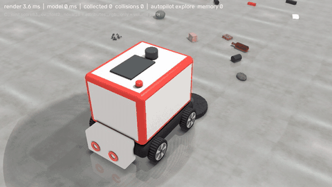
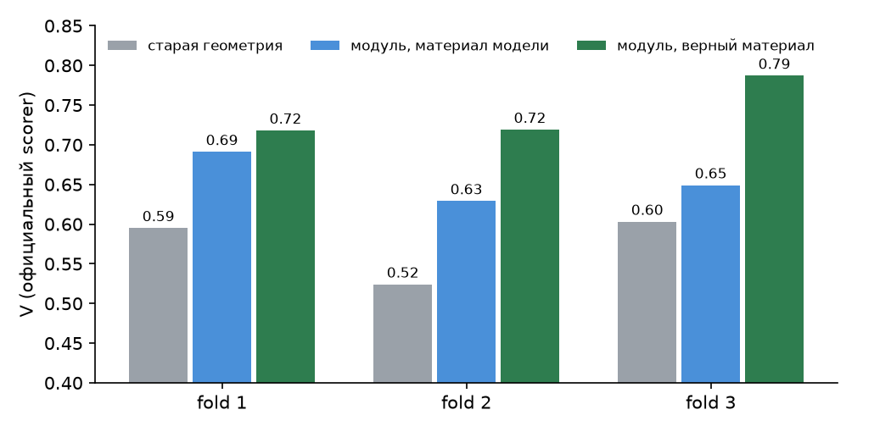
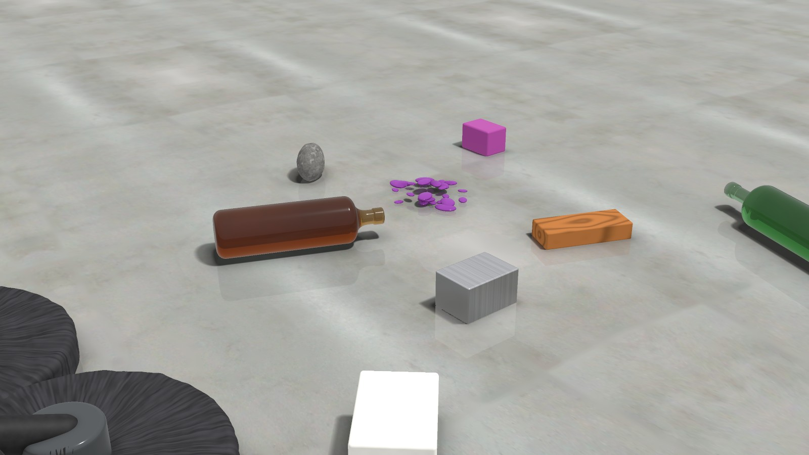
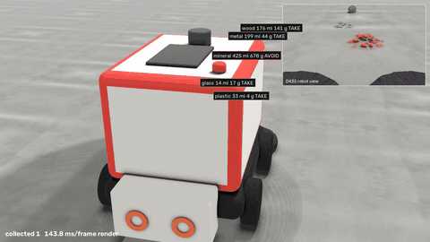
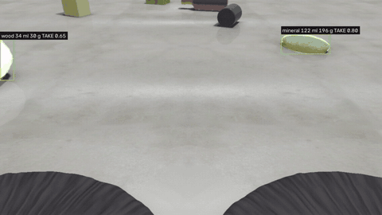
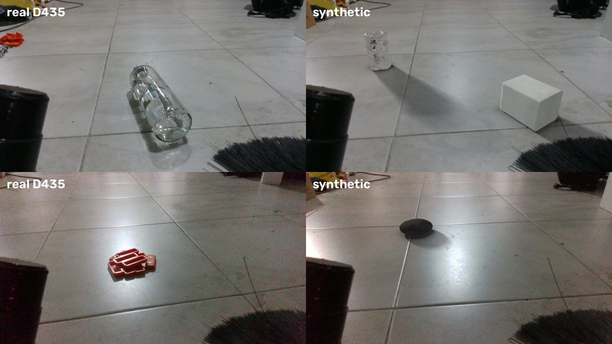
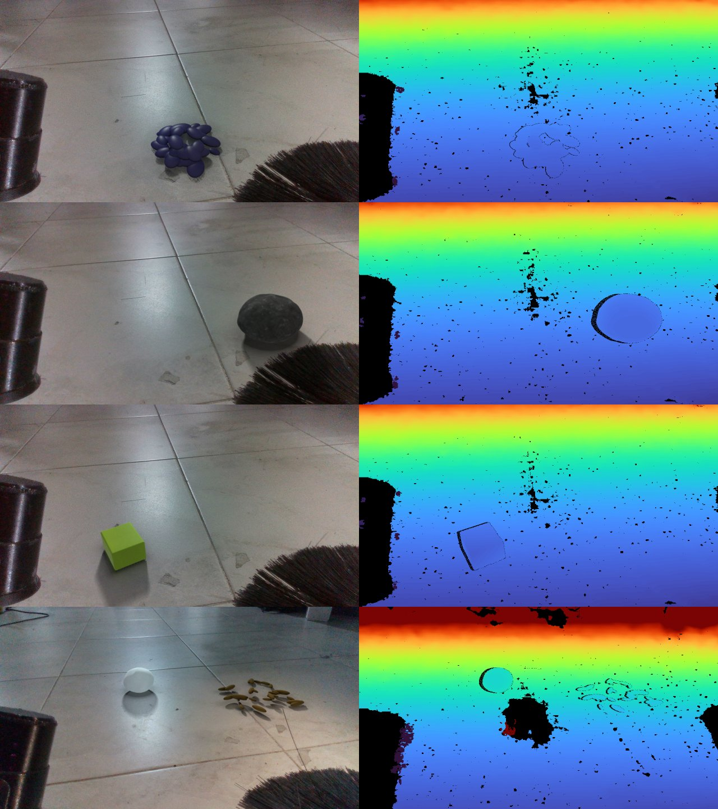

<div align="center">

# Cleaner — что под щёткой

**Робот-уборщик Astramis: по одному кадру RGB-D находит мусор и решает, что забрать, а что объехать**

Хакатон ЦУ · RealSense D435 · YOLO11-seg + RGB-D атрибуты · свой рендер реального времени на CUDA



*Живой полигон: робот ездит на решениях нашей модели. Зелёное — модель решила забрать, красное — объехать.*

[Модуль объёма](#модуль-объёма) · [Полигон](#полигон) · [Запуск](#запуск) · [Модель](#архитектура-модели) · [Данные](#данные)

</div>

> Код полигона (`polygon/`) и модуля объёма (`volume/`, `geometry/volume_parts.py`) лежит в ветке
> [`volume-parts`](https://github.com/Alexsam1075/Cleaner/tree/volume-parts). Навигация — `tools/nav.py`.

Для каждого предмета: форма, материал, объём и решение take. Метрика кейса:
`Score = 100 · (0.40·D + 0.20·M + 0.25·V + 0.15·S)` — детекция и форма, материал, объём, решение take.

## Материалы проекта

- [Итоговый CSV](deliverables/submission_best.csv) с предсказаниями для 137 тестовых кадров.
- [Презентация AI B2B SaaShka](deliverables/AI%20B2B%20SaaShka.pdf) в формате PDF.


## Что в репозитории

| Часть | Что делает | Где |
|---|---|---|
| Модель | YOLO11-seg детектор + ResNet-18 с RGB-D веткой (форма, материал, take) | `train.py`, `validate.py`, `predict.py`, `models/`, `training/` |
| Модуль объёма | Объём и масса по глубине, маске, плоскости пола, форме и материалу | `volume/`, `geometry/volume_parts.py`, `docs/VOLUME.md` |
| Навигация | Маршрут объезда по одному кадру, режим осторожности по массе | `tools/nav.py`, `tools/README_nav.md` |
| Полигон | Свой рендер реального времени, генератор мусора, модель D435, цифровой робот | `polygon/` |

## Модуль объёма

Облако точек над полом → чистка шума по шуму пола (3σ) → карта высот 4 мм → невидимая сторона достраивается зеркально через гребень → предмет режется на части, на каждую подгоняется фигура (коробка, цилиндр, эллипсоид, купол) → несколько оценок объединяет поправка по форме и материалу в лог-шкале с изломами на 50 и 300 мл. Для стекла без глубины объём считается по отпечатку маски на полу с учётом высоты класса. Масса = объём × плотность класса.



| Проверка (официальный scorer, V) | Старая геометрия | Модуль, материал модели | Модуль, верный материал |
|---|---:|---:|---:|
| fold 1, маски детектора | 0.595 | 0.691 | 0.718 |
| fold 2, маски детектора | 0.524 | 0.629 | 0.719 |
| fold 3, маски детектора | 0.603 | 0.649 | 0.787 |
| GT-маски, grouped CV по `object_id` (5×3) | 0.565 | — | 0.764 |

Чем точнее материал на входе, тем точнее объём. Объём из модуля подставляется в любой submission:

```bash
python -m volume.submission --submission in.csv --out out.csv --detector detector.pt \
    --labels val_labels.json            # посчитать метрику; --oracle-material — потолок с верным материалом
```

Из кода: `VolumeEstimator.load(...).estimate(depth, mask, plane, form, material)`. Подробности, честная валидация по фолдам и пересборка калибратора — в [`docs/VOLUME.md`](docs/VOLUME.md).

## Полигон

### Рендер реального времени

Весь кадр считается одним CUDA-ядром (`polygon/fastrt_kernel.cu`): один поток GPU — один пиксель. Сцена задаётся таблицей примитивов (SDF) и материалов; в ядре трассировка, GGX, мягкие тени, затенение в углах, отражения в глянцевой плитке, преломление в стекле, текстура пола с MIP. Ядро собирается во время запуска через NVRTC из пакета torch и запускается через CUDA driver API, отдельные зависимости не нужны.



| Сцена | Время кадра (V100, общий с другими задачами) |
|---|---:|
| Простая сцена 960×540 | 1.7 мс |
| Робот и мусор 960×540, 2 сэмпла на пиксель | 15–30 мс |
| Кадр датасета 1280×720 на реальном полу | 4.7 мс |

### Цифровой робот

Модель собрана по фотографиям: корпус с красной окантовкой и логотипом, чёрное основание, гусеницы с катками (грунтозацепы бегут по контуру ленты со скоростью своей стороны, бортовой поворот), две щётки, D435 на высоте 0.25 м под наклоном 30°, лидар, планшет, кнопка остановки, съёмный бак.



### Наша модель в симуляторе

Кадр с камеры робота рендерится с интринсиками из `camera.json`, получает модель глубины D435 и `meta.json` с плоскостью пола — и идёт в тот же `predict_frame`, что и для сабмита. Полигон огорожен стенами, на нём стоят стол, стулья, коробки, вёдра и колонны, около трети мусора тяжёлый (кирпичи, большие камни, полные бутылки, болванки). Стены и мебель робот видит лидаром и физически в них упирается; мусор видит только наша модель. Автопилот держит память объектов в координатах пола, едет к тому, что модель назвала TAKE, объезжает AVOID и препятствия (разворот, проезд вдоль, задний ход после касания), при пустом кадре прочёсывает полигон полосами. Счётчики наездов на тяжёлый мусор и касаний мебели показывают, где ошибаются модель и автопилот.



### Генератор обучающих кадров

Процедурный мусор (бутылки, банки, коробки, бруски, камни, мятая бумага, россыпи) с известными материалом, точным объёмом, массой и take рендерится в настоящие пустые кадры пола из train. Свет восстанавливается по блику на плитке, яркость — по полу рядом с предметом. Глубина повторяет D435: шум растёт с z², летающие пиксели на краях, стереотень слева от предметов (база 50 мм), дыры на стекле и бликах металла, шаг 1 мм. Выход — в формате датасета (COCO + color/depth/meta). Кадры тест-сплита не используются.





### Запуск

```bash
# живой полигон: на GPU-сервере, затем ssh -L 8790:localhost:8790 и http://localhost:8790
python -m polygon.live --port 8790
#   мышь — камера, W A S D — робот, P — автопилот по модели, V — что видит модель, G — истина, пробел — мусор

python -m polygon.generate_fast --out polygon_data --n 2000 --seed 0     # обучающие кадры
python -m polygon.animate_fast --out polygon_out/robot.mp4               # анимация робота
python -m polygon.record --seconds 50 && python -m polygon.make_media    # медиа для README
python -m pytest tests -q --import-mode=importlib                        # тесты
```

## Данные

263 реальных кадра train (214 объектов, 49 пустых кадров), 600 синтетических кадров (678 объектов), 137 реальных кадров теста. В train всего 40 физических предметов (`object_id`), каждый есть и в синтетике с теми же атрибутами. Поэтому валидация только по группам `object_id`, а синтетика с предметами валидационного фолда выкидывается из обучения. Аудит данных: `python -m datasets.audit` → `references/data_audit.md`.

## Архитектура модели

- **Детектор и сегментация:** YOLO11n-seg, дообученный на выбранной конфигурации real/synth. Scorer берёт рамки, маски идут в геометрию.
- **Атрибуты:** ResNet-18 + RGB-D ветка высоты над полом, отдельные головы формы, материала, take (и вспомогательные log-объём и log-масса). Варианты слияния: `rgb_only`, `late`, `intermediate`, `intermediate_geom`.
- **Геометрия:** глубина разворачивается по `camera.json`, нормируется по `floor_plane` кадра; невалидная глубина остаётся явным признаком.

| Эксперимент | Детектор | Атрибуты |
|---|---|---|
| `A_real` | только real | только real |
| `B_synth_then_real` | предобучение на synth, дообучение на real | то же |
| `C_joint` | real + synth вместе | то же |
| `D_domain_randomized` | real + synth с сильной аугментацией | то же, с цветовой рандомизацией |

```bash
bash setup_aionlab.sh && source .venv/bin/activate
python train.py --data-root datasets/raw --device 0
python validate.py --experiment C_joint --fusion rgb_only
python predict.py --experiment C_joint --fusion rgb_only --volume-backend parts \
    --volume-calibrator checkpoints/volume_parts/calibrator.json
```

## Воспроизводимость

- Фиксированный сид и сохранённое разбиение по `object_id`: `configs/object_id_split.json`, копия запуска — `logs/object_id_split.json`.
- Метки теста не читаются никогда; валидационные метки берутся только из `real_train.json`; `score.py` не редактируется (копия в `references/`).
- Датасет (`datasets/raw/`) и архивы `*.tar.gz` в git не входят.
- Журнал экспериментов — `DEVLOG.md`, план по компонентам — `reports/ROADMAP_SCORE_100_2026-11-21.md`.


#Результаты хакатона:
проигрыш...
